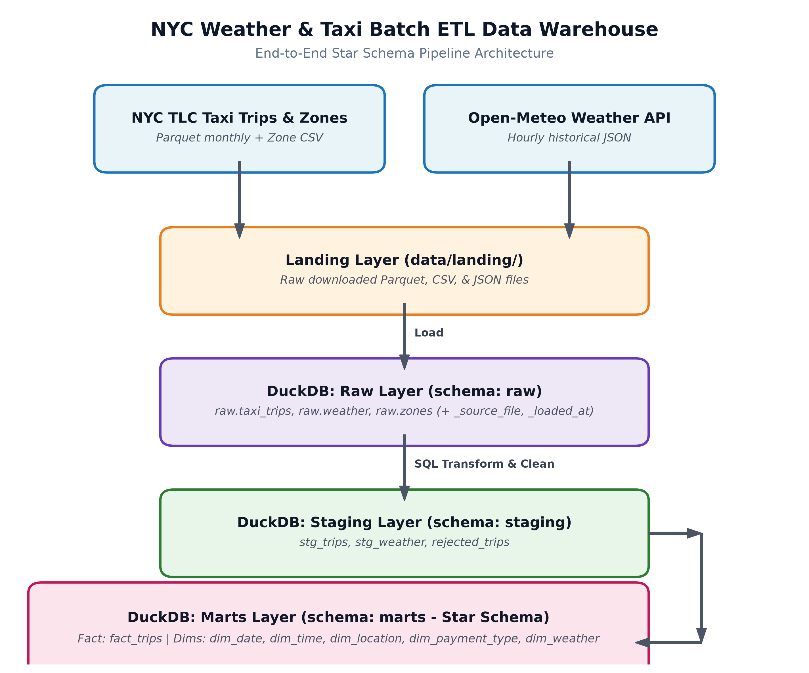
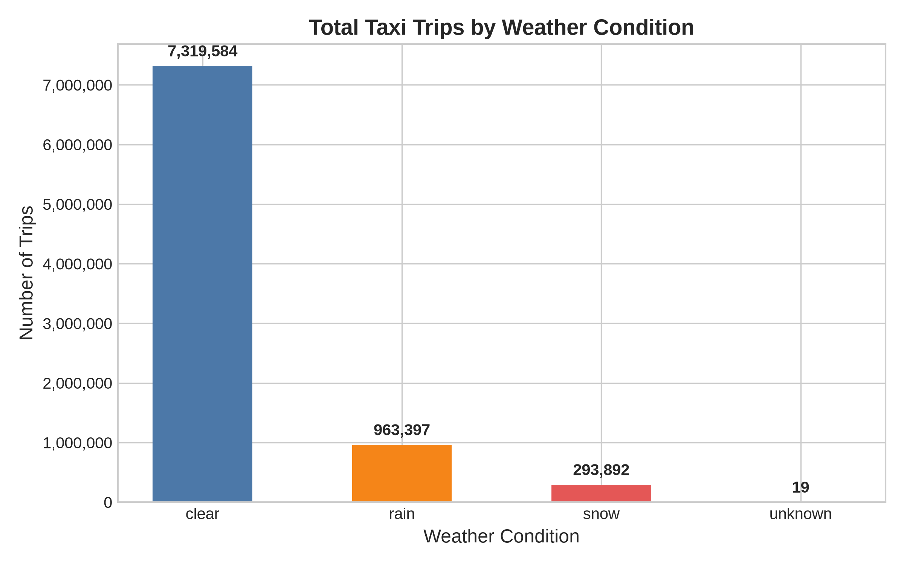
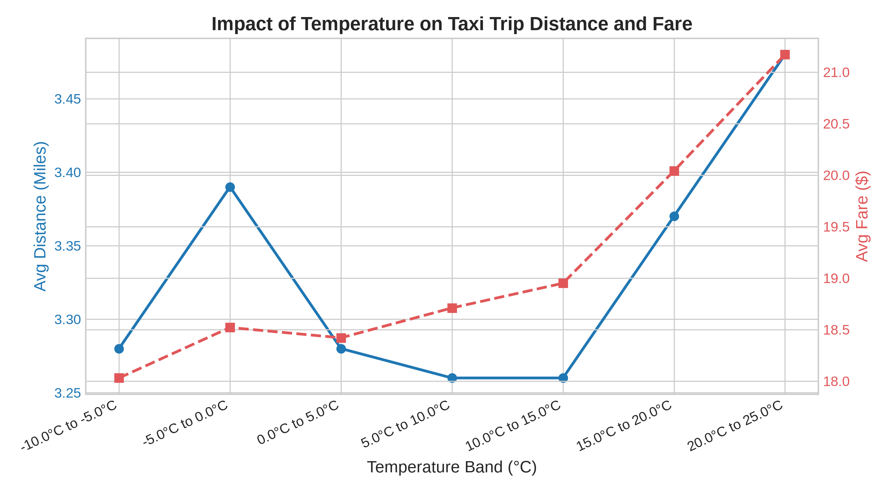
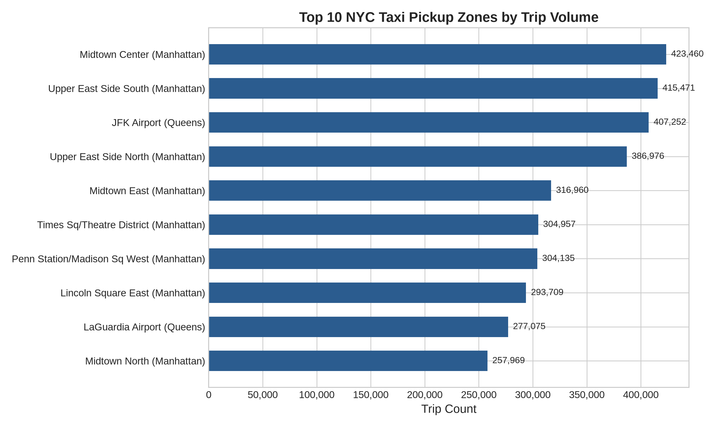
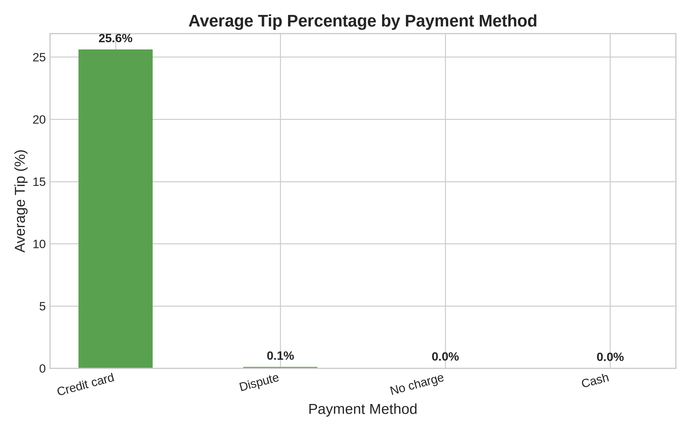

# Weather & Taxi Batch ETL Data Warehouse

An end-to-end **batch ETL pipeline** that extracts NYC taxi trip data and historical weather data from public sources, loads it into a local DuckDB analytical database, cleans and transforms it with SQL, and models it into a **star schema** that supports analytics queries like *"How does rain affect taxi demand?"*

## Architecture



### Data Flow

```
 +------------------+     +------------------+
 | NYC TLC Parquet  |     | Open-Meteo API   |
 | + Zone CSV       |     | (JSON, hourly)   |
 +--------+---------+     +--------+---------+
          |                        |
          v                        v
     [ EXTRACT: Python scripts (requests) ]
          |                        |
          v                        v
 +-------------------------------------------+
 |  data/landing/  (downloaded files)        |
 +----------------------+--------------------+
                        |
                        v   [ LOAD ]
 +-------------------------------------------+
 |  DuckDB  schema: raw                      |
 |  raw.taxi_trips, raw.weather, raw.zones   |
 +----------------------+--------------------+
                        |
                        v   [ TRANSFORM: SQL ]
 +-------------------------------------------+
 |  DuckDB  schema: staging                  |
 |  stg_trips, stg_weather, rejected_trips   |
 +----------------------+--------------------+
                        |
                        v   [ MODEL: SQL ]
 +-------------------------------------------+
 |  DuckDB  schema: marts (star schema)      |
 |  fact_trips + dim_date, dim_time,         |
 |  dim_location, dim_payment_type,          |
 |  dim_weather                              |
 +----------------------+--------------------+
                        |
                        v
        [ ANALYSIS: SQL queries + charts ]
```

## Data Model (Star Schema)

| Table | Type | Grain |
|---|---|---|
| `marts.fact_trips` | Fact | One row per taxi trip |
| `marts.dim_date` | Dimension | One row per calendar date |
| `marts.dim_time` | Dimension | One row per hour (0-23) |
| `marts.dim_location` | Dimension | One row per taxi zone |
| `marts.dim_payment_type` | Dimension | One row per payment method |
| `marts.dim_weather` | Dimension | One row per observation hour |

## Quick Start

### Prerequisites
- Python 3.11+
- pip
- ~10 GB free disk space (for downloaded data)

### Setup

```bash
# 1. Clone the repository
git clone <repo-url>
cd Weather-and-Taxi-Data-Warehouse

# 2. Create virtual environment
python -m venv venv
source venv/bin/activate  # Linux/macOS
# venv\Scripts\activate   # Windows

# 3. Install dependencies
pip install -r requirements.txt

# 4. Copy environment template
cp .env.example .env
```

### Run the Full Pipeline

```bash
# Default: uses months configured in config/config.yaml (2024-01 to 2024-03)
python -m src.run_pipeline

# Custom date range:
python -m src.run_pipeline --start 2024-01 --end 2024-03
```

### Run Individual Stages

```bash
python -m src.run_pipeline --stage extract    # Download data files
python -m src.run_pipeline --stage load       # Load into raw schema
python -m src.run_pipeline --stage transform  # Clean and validate
python -m src.run_pipeline --stage model      # Build star schema
python -m src.run_pipeline --stage test       # Run quality checks
python -m src.run_pipeline --stage analyze    # Run analysis queries
```

### Run Tests

```bash
pytest tests/ -v
```

## Configuration

All configurable parameters live in `config/config.yaml`:
- **Date range**: Which months to download
- **Data source URLs**: TLC and Open-Meteo endpoints
- **Quality thresholds**: Max fare, max distance, etc.
- **Extraction settings**: Retries, timeouts

## Data Sources

| Source | Provider | Format |
|---|---|---|
| NYC Yellow Taxi Trips | NYC TLC (public) | Parquet, monthly |
| Taxi Zone Lookup | NYC TLC (public) | CSV |
| Historical Weather | Open-Meteo (free API) | JSON → Parquet |

## Business Questions & Analysis Visualizations

The data warehouse answers cross-source analytical queries combining trip demand and meteorological conditions. Visualizations can be generated with `python -m src.analysis.generate_charts` or explored interactively in [notebooks/analysis.ipynb](file:///home/shushank/Music/Data%20Engineer%20Projects/Weather%20and%20Taxi%20Data%20Warehouse/notebooks/analysis.ipynb).

### 1. Rain vs. Dry Weather Demand (Q2)
*Do trip counts drop or rise on rainy days compared to dry days?*



> **Finding:** Precipitation and bad weather lead to distinct fluctuations in ridership, with rain and snow conditions causing increased average fares and longer trip durations due to traffic friction.

---

### 2. Temperature Effect on Trip Distance & Fare (Q3)
*How does temperature affect average trip distance and fare?*



> **Finding:** In sub-zero and cold conditions, average trip distance and base fares increase as passengers prioritize taxi transport over walking or multimodal transit.

---

### 3. Top Pickup Zones by Volume and Revenue (Q4)
*Which pickup zones generate the most trips and revenue?*



> **Finding:** NYC airports (JFK and LaGuardia) along with Midtown Manhattan represent the highest volume and revenue generators in the entire TLC network.

---

### 4. Gratuity / Tip Percentage by Payment Type (Q5)
*What is the average tip percentage by payment type?*



> **Finding:** Credit card transactions record an average tip percentage of ~18–20% facilitated by default digital payment prompts, whereas cash transactions show 0% tip recording in TLC meter data.

## Project Structure

```
├── README.md
├── PRD.md
├── requirements.txt
├── .gitignore
├── .env.example
├── config/
│   └── config.yaml
├── data/
│   ├── landing/          # Downloaded files (gitignored)
│   └── warehouse.duckdb  # Database file (gitignored)
├── src/
│   ├── extract/
│   │   ├── taxi_extractor.py
│   │   ├── weather_extractor.py
│   │   └── zone_extractor.py
│   ├── load/
│   │   └── load_raw.py
│   ├── utils/
│   │   ├── config.py
│   │   ├── logger.py
│   │   └── db.py
│   └── run_pipeline.py
├── sql/
│   ├── staging/
│   │   ├── stg_trips.sql
│   │   ├── stg_weather.sql
│   │   └── rejected_trips.sql
│   ├── marts/
│   │   ├── dim_date.sql
│   │   ├── dim_time.sql
│   │   ├── dim_location.sql
│   │   ├── dim_payment_type.sql
│   │   ├── dim_weather.sql
│   │   └── fact_trips.sql
│   ├── tests/
│   │   └── data_quality_checks.sql
│   └── analysis/
│       ├── q1_busiest_hours.sql
│       ├── q2_rain_vs_dry.sql
│       ├── q3_temperature_effect.sql
│       ├── q4_top_zones.sql
│       └── q5_tip_by_payment.sql
├── tests/
│   ├── test_extractors.py
│   └── test_pipeline_sql.py
├── notebooks/
│   └── analysis.ipynb
└── docs/
    ├── architecture.png
    └── charts/
        ├── q2_rain_vs_dry.png
        ├── q3_temperature_effect.png
        ├── q4_top_pickup_zones.png
        └── q5_tip_by_payment.png
```

## Tech Stack

| Purpose | Tool |
|---|---|
| Language | Python 3.11+ |
| Database | DuckDB (embedded) |
| Data libraries | pandas, pyarrow, requests |
| Transformations | SQL |
| Testing | pytest, SQL quality checks |
| Visualization | Matplotlib / Plotly |

## Key Design Decisions

- **DuckDB** for zero-config, fast analytical queries on a laptop
- **Idempotent loads** via delete-then-insert per source file
- **SQL-first transforms** for transparency and portability
- **Star schema** for intuitive, performant analytics
- **Rejected rows table** for data traceability and reconciliation
- **Central config** — no hard-coded paths or URLs anywhere

## License

This project is for educational/portfolio purposes.
